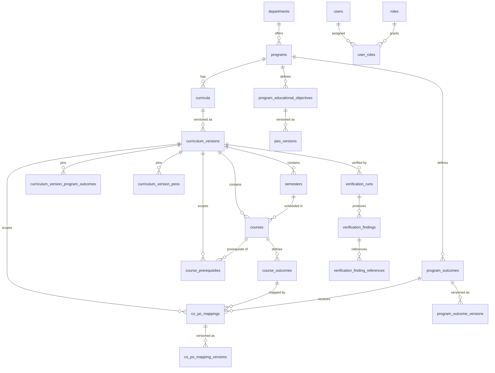

# LLD: Database Schema

## 1. Purpose

This document defines the low-level design of the relational database
schema for the AI-Powered Curriculum Intelligence & Verification
Framework. It is derived from the functional requirements
(`docs/requirements/functional_requirements/`) and the non-functional
requirements (`docs/requirements/non-functional-requirements/`).

PostgreSQL is the primary relational database (see `AGENTS.md`).
Schema changes are applied through migrations; production schema is
never modified manually.

## 2. Technology and Conventions

| Item | Decision |
| --- | --- |
| Database | PostgreSQL 16+ |
| Migration tool | Alembic (`backend/alembic/`) |
| Primary keys | `UUID` generated with `gen_random_uuid()` |
| Timestamps | `TIMESTAMPTZ` (UTC), default `now()` |
| Status values | `VARCHAR` with `CHECK` constraints (evolvable via migration) |
| Soft delete | Status columns / removal timestamps; rows are not physically deleted when historical records reference them |
| `updated_at` | Maintained by a shared trigger (`set_updated_at()`) |
| Naming | `snake_case`; unique constraints `uq_*`, checks `chk_*`, foreign keys `fk_*` |

UUID primary keys are used so that entities keep a stable identity
when they are also represented as nodes in the Neo4j curriculum graph
and referenced by AI verification findings.

## 3. Domain Model Overview



## 4. Table Catalog

### 4.1 Identity and Access (FR-01)

#### `users`

Registered system users.

| Column | Type | Notes |
| --- | --- | --- |
| `id` | UUID PK | |
| `username` | VARCHAR(100) | unique, not null |
| `email` | VARCHAR(255) | unique, not null |
| `password_hash` | VARCHAR(255) | not null; never store plaintext |
| `full_name` | VARCHAR(200) | not null |
| `status` | VARCHAR(20) | `ACTIVE`, `INACTIVE`, `LOCKED` |
| `last_login_at` | TIMESTAMPTZ | nullable |
| `created_at`, `updated_at` | TIMESTAMPTZ | not null |

#### `roles`

| Column | Type | Notes |
| --- | --- | --- |
| `id` | UUID PK | |
| `code` | VARCHAR(50) | unique; seeded: `ADMIN`, `COMMITTEE_MEMBER`, `FACULTY`, `REVIEWER` |
| `name`, `description` | VARCHAR | not null / nullable |
| `created_at` | TIMESTAMPTZ | not null |

#### `user_roles`

Many-to-many assignment of roles to users.

| Column | Type | Notes |
| --- | --- | --- |
| `user_id` | UUID FK → `users` | PK part, cascade delete |
| `role_id` | UUID FK → `roles` | PK part |
| `assigned_by` | UUID FK → `users` | nullable |
| `assigned_at` | TIMESTAMPTZ | not null |

These tables back the FastAPI authentication module. Access tokens are
stateless JWTs issued by `POST /api/v1/auth/login`; authorization checks
resolve role codes through `user_roles` (see
`docs/lld/authentication.md`).

### 4.2 Academic Structure (FR-02)

#### `departments`

| Column | Type | Notes |
| --- | --- | --- |
| `id` | UUID PK | |
| `code` | VARCHAR(20) | unique, not null |
| `name` | VARCHAR(200) | not null |
| `status` | VARCHAR(20) | `ACTIVE`, `INACTIVE` |
| `created_at`, `updated_at` | TIMESTAMPTZ | not null |

#### `programs`

| Column | Type | Notes |
| --- | --- | --- |
| `id` | UUID PK | |
| `department_id` | UUID FK → `departments` | not null |
| `code` | VARCHAR(20) | unique, not null |
| `name` | VARCHAR(200) | not null |
| `degree_type` | VARCHAR(50) | e.g. `B.Tech` |
| `duration_years` | NUMERIC(3,1) | `> 0` |
| `status` | VARCHAR(20) | `ACTIVE`, `INACTIVE` |
| `created_at`, `updated_at` | TIMESTAMPTZ | not null |

#### `curricula`

The logical curriculum of a program for a given regulation
(e.g. B.Tech CSE, Regulation 2026). Content lives in
`curriculum_versions`; this table is the stable identity used for
version history.

| Column | Type | Notes |
| --- | --- | --- |
| `id` | UUID PK | |
| `program_id` | UUID FK → `programs` | not null |
| `academic_year` | VARCHAR(20) | e.g. `2026-27` |
| `regulation` | VARCHAR(50) | unique per program |
| `title` | VARCHAR(200) | nullable |
| `description` | TEXT | nullable; generated program summary |
| `duration_years` | NUMERIC(3,1) | `> 0` |
| `status` | VARCHAR(20) | `ACTIVE`, `ARCHIVED` |
| `created_by` | UUID FK → `users` | not null |
| `created_at`, `updated_at` | TIMESTAMPTZ | not null |

The department is reached through `programs.department_id`
(FR-02 "associate with a program and department"); storing it twice
would allow inconsistent data.

### 4.3 Curriculum Versioning (FR-02, FR-03, FR-04)

#### `curriculum_versions`

| Column | Type | Notes |
| --- | --- | --- |
| `id` | UUID PK | |
| `curriculum_id` | UUID FK → `curricula` | not null |
| `version_label` | VARCHAR(20) | unique per curriculum; initial version `1.0` |
| `status` | VARCHAR(20) | `DRAFT`, `UNDER_REVIEW`, `APPROVED`, `PUBLISHED`, `ARCHIVED` |
| `previous_version_id` | UUID FK → `curriculum_versions` | preserves successor relationship (FR-04) |
| `change_summary` | TEXT | nullable |
| `created_by` | UUID FK → `users` | not null |
| `published_by` | UUID FK → `users` | nullable |
| `created_at`, `updated_at`, `published_at` | TIMESTAMPTZ | |

Status lifecycle:

```text
DRAFT -> UNDER_REVIEW -> APPROVED -> PUBLISHED -> ARCHIVED
```

- Only `DRAFT` versions are editable (FR-03, FR-05..FR-07).
- `PUBLISHED` versions are immutable. The database stores the state;
  immutability of content rows is enforced in the service layer
  because it spans multiple tables (see section 6.3).
- Editing a published version creates a new version whose
  `previous_version_id` points at the source version (FR-04).

#### `semesters`

| Column | Type | Notes |
| --- | --- | --- |
| `id` | UUID PK | |
| `curriculum_version_id` | UUID FK → `curriculum_versions` | cascade delete |
| `semester_number` | SMALLINT | unique per version, `> 0` |
| `name` | VARCHAR(100) | nullable |
| `focus` | TEXT | nullable; generated semester focus |
| `created_at` | TIMESTAMPTZ | not null |

`UNIQUE (id, curriculum_version_id)` exists so that child tables can
enforce "belongs to the same curriculum version" with composite
foreign keys.

### 4.4 Course Management (FR-05, FR-06, FR-07)

#### `course_types`

Reference data for valid course types (`CORE`, `ELECTIVE`, `LAB`,
`PROJECT`, `SEMINAR`, `INTERNSHIP` are seeded).

| Column | Type | Notes |
| --- | --- | --- |
| `id` | UUID PK | |
| `code` | VARCHAR(30) | unique |
| `name` | VARCHAR(100) | not null |
| `description` | VARCHAR(500) | nullable |
| `is_active` | BOOLEAN | default true |
| `created_at` | TIMESTAMPTZ | not null |

#### `courses`

A course within one curriculum version.

| Column | Type | Notes |
| --- | --- | --- |
| `id` | UUID PK | |
| `curriculum_version_id` | UUID FK → `curriculum_versions` | cascade delete |
| `semester_id` | UUID | not null |
| `course_code` | VARCHAR(30) | unique among active courses of the version |
| `course_name` | VARCHAR(200) | not null |
| `course_type_id` | UUID FK → `course_types` | not null |
| `credits` | NUMERIC(4,1) | `> 0` |
| `contact_hours` | INTEGER | nullable, `>= 0` |
| `description` | TEXT | nullable |
| `syllabus` | TEXT | nullable |
| `status` | VARCHAR(20) | `ACTIVE`, `REMOVED` |
| `created_by`, `updated_by`, `removed_by` | UUID FK → `users` | |
| `created_at`, `updated_at`, `removed_at` | TIMESTAMPTZ | |

Integrity:

- `FOREIGN KEY (semester_id, curriculum_version_id)` →
  `semesters (id, curriculum_version_id)`: a course can only be
  assigned to a semester of its own curriculum version (FR-05
  validation rule).
- Partial unique index
  `uq_courses_code_active (curriculum_version_id, course_code) WHERE status = 'ACTIVE'`:
  course codes are unique within the version, while a removed code
  may be re-added.
- `UNIQUE (id, curriculum_version_id)` supports composite foreign
  keys from `course_outcomes` and `course_prerequisites`.

Removal (FR-07) is a soft delete: `status = 'REMOVED'` with
`removed_by` / `removed_at`, preserving history and referential
integrity. Dependency checks (prerequisite/corequisite references)
are performed in the service layer before removal.

#### `course_outcomes`

Course Outcomes (COs) of a course. Managed within the course editing
flows of FR-03/FR-06; consumed by FR-10.

| Column | Type | Notes |
| --- | --- | --- |
| `id` | UUID PK | |
| `course_id` | UUID | not null |
| `curriculum_version_id` | UUID | not null; denormalized to enable composite integrity |
| `co_code` | VARCHAR(30) | unique among active COs of the course |
| `description` | TEXT | not null, non-blank |
| `status` | VARCHAR(20) | `ACTIVE`, `INACTIVE` |
| `created_by`, `updated_by` | UUID FK → `users` | |
| `created_at`, `updated_at` | TIMESTAMPTZ | |

Integrity: `FOREIGN KEY (course_id, curriculum_version_id)` →
`courses (id, curriculum_version_id)` and
`UNIQUE (id, curriculum_version_id)`.

### 4.5 Program Outcomes and PEOs (FR-08, FR-09)

#### `program_outcomes`

Logical PO identity of a program (FR-08).

| Column | Type | Notes |
| --- | --- | --- |
| `id` | UUID PK | |
| `program_id` | UUID FK → `programs` | not null |
| `po_code` | VARCHAR(30) | unique per program (BR-PO-01) |
| `status` | VARCHAR(20) | `ACTIVE`, `INACTIVE` (deactivation, BR-PO-05) |
| `created_by` | UUID FK → `users` | not null |
| `created_at`, `updated_at` | TIMESTAMPTZ | not null |

#### `program_outcome_versions`

Immutable content versions of a PO (FR-08-05, BR-PO-06).

| Column | Type | Notes |
| --- | --- | --- |
| `id` | UUID PK | |
| `program_outcome_id` | UUID FK → `program_outcomes` | cascade delete |
| `version_number` | INTEGER | unique per PO |
| `description` | TEXT | not null, non-blank |
| `effective_date` | DATE | nullable until approved |
| `status` | VARCHAR(20) | `DRAFT`, `PROPOSED`, `APPROVED`, `REJECTED`, `SUPERSEDED` |
| `review_comments` | TEXT | nullable |
| `created_by`, `approved_by` | UUID FK → `users` | |
| `created_at`, `approved_at` | TIMESTAMPTZ | |

- Partial unique index `uq_po_versions_approved` on
  `(program_outcome_id) WHERE status = 'APPROVED'`: at most one
  effective version per PO. When a newer version is approved the
  previous one is marked `SUPERSEDED`.
- `UNIQUE (id, program_outcome_id)` supports the composite foreign
  key used by `curriculum_version_program_outcomes`.

#### `program_educational_objectives`

Logical PEO identity of a program (FR-09); same shape as
`program_outcomes` with `peo_code`.

#### `peo_versions`

Version content of a PEO (FR-09-05); same shape and constraints as
`program_outcome_versions`.

#### `curriculum_version_program_outcomes`

Pins which PO **version** applies to a curriculum version so that
historical versions keep referencing the correct PO content
(FR-08-05, BR-PO-06).

| Column | Type | Notes |
| --- | --- | --- |
| `curriculum_version_id` | UUID FK → `curriculum_versions` | PK part, cascade delete |
| `program_outcome_id` | UUID FK → `program_outcomes` | PK part |
| `program_outcome_version_id` | UUID | composite FK `(program_outcome_version_id, program_outcome_id)` |
| `added_by` | UUID FK → `users` | not null |
| `added_at` | TIMESTAMPTZ | not null |

#### `curriculum_version_peos`

Same design for PEOs (FR-09-05).

### 4.6 CO-PO Mapping (FR-10)

#### `mapping_levels`

Configurable institutional mapping scale; not hard-coded
(FR-10 Notes). Seeds: `LOW` (1), `MEDIUM` (2), `HIGH` (3).

| Column | Type | Notes |
| --- | --- | --- |
| `id` | UUID PK | |
| `code` | VARCHAR(20) | unique |
| `name` | VARCHAR(100) | not null |
| `numeric_value` | SMALLINT | unique, `> 0` |
| `description` | VARCHAR(500) | nullable |
| `is_active` | BOOLEAN | default true |
| `sort_order` | SMALLINT | default 0 |
| `created_at` | TIMESTAMPTZ | not null |

#### `co_po_mappings`

Logical mapping between a CO and a PO within a curriculum version
(BR-COPO-03 uniqueness, BR-COPO-06 preservation).

| Column | Type | Notes |
| --- | --- | --- |
| `id` | UUID PK | |
| `curriculum_version_id` | UUID FK → `curriculum_versions` | cascade delete |
| `course_outcome_id` | UUID | composite FK `(course_outcome_id, curriculum_version_id)` |
| `program_outcome_id` | UUID | composite FK `(curriculum_version_id, program_outcome_id)` |
| `status` | VARCHAR(20) | `ACTIVE`, `INACTIVE` |
| `created_by` | UUID FK → `users` | not null |
| `created_at`, `updated_at` | TIMESTAMPTZ | not null |

Integrity:

- `FOREIGN KEY (course_outcome_id, curriculum_version_id)` →
  `course_outcomes (id, curriculum_version_id)`: the CO belongs to a
  course of this curriculum version (VR-COPO-01).
- `FOREIGN KEY (curriculum_version_id, program_outcome_id)` →
  `curriculum_version_program_outcomes`: the PO is registered for
  this curriculum version (VR-COPO-02/VR-COPO-05).
- Partial unique index
  `uq_co_po_mappings_active (curriculum_version_id, course_outcome_id, program_outcome_id) WHERE status = 'ACTIVE'`:
  no duplicate active mappings (BR-COPO-03, EX-COPO-04).
- The effective mapping level lives in `co_po_mapping_versions`.

#### `co_po_mapping_versions`

Versioned mapping content (FR-10-05): level/strength, effective date,
status, approval metadata.

| Column | Type | Notes |
| --- | --- | --- |
| `id` | UUID PK | |
| `mapping_id` | UUID FK → `co_po_mappings` | cascade delete |
| `version_number` | INTEGER | unique per mapping |
| `mapping_level_id` | UUID FK → `mapping_levels` | not null |
| `effective_date` | DATE | nullable until approved |
| `status` | VARCHAR(20) | `DRAFT`, `PROPOSED`, `APPROVED`, `REJECTED`, `SUPERSEDED` |
| `review_comments` | TEXT | nullable |
| `created_by`, `approved_by` | UUID FK → `users` | |
| `created_at`, `approved_at` | TIMESTAMPTZ | |

Partial unique index `uq_co_po_mapping_versions_approved` on
`(mapping_id) WHERE status = 'APPROVED'`.

### 4.7 Prerequisites (FR-11)

#### `course_prerequisites`

Directed prerequisite relationship: `prerequisite_course_id` must be
completed before `target_course_id` (FR-11 Notes).

| Column | Type | Notes |
| --- | --- | --- |
| `id` | UUID PK | |
| `curriculum_version_id` | UUID FK → `curriculum_versions` | cascade delete |
| `prerequisite_course_id` | UUID | composite FK to `courses (id, curriculum_version_id)` |
| `target_course_id` | UUID | composite FK to `courses (id, curriculum_version_id)` |
| `status` | VARCHAR(20) | `PROPOSED`, `APPROVED`, `REJECTED`, `REMOVED` |
| `review_comments` | TEXT | nullable |
| `created_by`, `approved_by` | UUID FK → `users` | |
| `created_at`, `approved_at`, `updated_at` | TIMESTAMPTZ | |

Integrity:

- Both courses must belong to the same curriculum version
  (BR-PR-01, BR-PR-05, VR-PR-01/VR-PR-05).
- `chk_course_prerequisites_not_self`: a course cannot be its own
  prerequisite (BR-PR-02, EX-PR-02).
- Partial unique index
  `uq_course_prerequisites_active (curriculum_version_id, prerequisite_course_id, target_course_id) WHERE status IN ('PROPOSED','APPROVED')`
  prevents duplicate relationships (BR-PR-04, EX-PR-04).
- Circular dependency detection (BR-PR-03, VR-PR-04) is a graph
  traversal performed in the service/verification layer; PostgreSQL
  cannot express it declaratively.
- `status = 'REMOVED'` implements FR-11-04 without destroying history
  (BR-PR-07).

Corequisite management is referenced by FR-07 (dependency check) but
no functional requirement defines it yet; it is listed as a future
extension (section 8).

### 4.8 Verification and Findings (NFR-01, FR-12)

#### `verification_runs`

Asynchronous AI verification job (NFR-01).

| Column | Type | Notes |
| --- | --- | --- |
| `id` | UUID PK | |
| `curriculum_version_id` | UUID FK → `curriculum_versions` | not null |
| `requested_by` | UUID FK → `users` | not null |
| `status` | VARCHAR(20) | `QUEUED`, `PROCESSING`, `COMPLETED`, `FAILED` |
| `requested_at` | TIMESTAMPTZ | not null, default `now()` |
| `started_at`, `completed_at` | TIMESTAMPTZ | nullable |
| `error_message` | TEXT | nullable |
| `summary` | JSONB | aggregate counts, engine metadata |

The API acknowledges the request immediately and returns the run
identifier; clients poll the run status until `COMPLETED` or
`FAILED` (NFR-01 acceptance criteria).

#### `verification_findings`

One potential issue produced by a run.

| Column | Type | Notes |
| --- | --- | --- |
| `id` | UUID PK | |
| `verification_run_id` | UUID FK → `verification_runs` | cascade delete |
| `category` | VARCHAR(50) | `STRUCTURAL`, `OUTCOME`, `DEPENDENCY`, `CONTENT`, `INDUSTRY_ALIGNMENT`, `ACCREDITATION_OBE` |
| `severity` | VARCHAR(20) | `INFO`, `LOW`, `MEDIUM`, `HIGH`, `CRITICAL` |
| `confidence` | NUMERIC(4,3) | `0..1` |
| `title` | VARCHAR(300) | not null |
| `description`, `evidence`, `recommendation` | TEXT | evidence and explanation are mandatory for explainability |
| `requires_human_review` | BOOLEAN | default true |
| `review_status` | VARCHAR(20) | `PENDING`, `ACCEPTED`, `REJECTED`, `MODIFIED` |
| `reviewed_by` | UUID FK → `users` | nullable |
| `reviewed_at` | TIMESTAMPTZ | nullable |
| `review_comments` | TEXT | nullable |
| `created_at` | TIMESTAMPTZ | not null |

The review columns implement the human workflow
"AI Analysis → Finding → Evidence → Faculty Review → Accept, Reject,
or Modify".

#### `verification_finding_references`

Links a finding to the entities it concerns (courses, outcomes,
mappings, ...) for the verification report.

| Column | Type | Notes |
| --- | --- | --- |
| `id` | UUID PK | |
| `finding_id` | UUID FK → `verification_findings` | cascade delete |
| `entity_type` | VARCHAR(50) | `CURRICULUM_VERSION`, `SEMESTER`, `COURSE`, `COURSE_OUTCOME`, `PROGRAM_OUTCOME`, `PEO`, `CO_PO_MAPPING`, `PREREQUISITE` |
| `entity_id` | UUID | not null |
| `note` | VARCHAR(500) | nullable |

A polymorphic reference is used because a finding may point at
several different entity types; each type is validated in the
service layer.

Prerequisite verification (FR-12) is executed as a verification run
scoped to the selected curriculum version. Its findings use category
`DEPENDENCY`, and `verification_finding_references` links them to the
affected courses and prerequisite relationships. Because a run is
bound to a curriculum version, historical versions are always
analyzed with their own prerequisite rows (BR-PV-06, BR-PV-07), and
executions and results are auditable through `audit_logs`
(BR-PV-08). No dedicated tables are required: the generic
verification model already carries status, issue type, severity,
explanation, involved courses/relationships, and timestamps
(FR-12-06).

### 4.9 Audit History (cross-cutting)

#### `audit_logs`

Append-only audit trail required by FR-06 ("all modifications shall
be recorded"), FR-07, FR-08 (BR-PO-07), FR-09 (BR-PEO-07), FR-10
(BR-COPO-08), and FR-11 (BR-PR-08).

| Column | Type | Notes |
| --- | --- | --- |
| `id` | BIGINT identity PK | high-volume append-only table |
| `entity_type` | VARCHAR(50) | e.g. `COURSE`, `PROGRAM_OUTCOME` |
| `entity_id` | UUID | nullable |
| `action` | VARCHAR(50) | `CREATE`, `UPDATE`, `REMOVE`, `DEACTIVATE`, `APPROVE`, `REJECT`, `PUBLISH`, ... |
| `actor_user_id` | UUID FK → `users` | nullable for system actions |
| `curriculum_version_id` | UUID FK → `curriculum_versions` | nullable context |
| `old_values`, `new_values`, `metadata` | JSONB | field-level before/after snapshots |
| `occurred_at` | TIMESTAMPTZ | not null, default `now()` |

### 4.10 Document Processing (FR-13)

#### `documents`

Uploaded curriculum documents with local-storage references and
LLM analysis results. Detailed design lives in
`document-processing.md`.

| Column | Type | Notes |
| --- | --- | --- |
| `id` | UUID PK | |
| `original_filename` | VARCHAR(255) | not null, stored basename |
| `file_extension` | VARCHAR(10) | not null, lowercase with dot |
| `content_type` | VARCHAR(100) | declared client content type |
| `size_bytes` | BIGINT | not null |
| `checksum_sha256` | VARCHAR(64) | not null, traceability |
| `storage_path` | VARCHAR(500) | not null, provider-relative key |
| `status` | VARCHAR(20) | `UPLOADED`, `PROCESSING`, `COMPLETED`, `FAILED` |
| `extracted_text` | TEXT | nullable; set on ingest |
| `llm_analysis` | JSONB | nullable; parsed LLM output |
| `llm_model` | VARCHAR(100) | nullable; model that produced the analysis |
| `error_message` | TEXT | nullable; set on FAILED |
| `uploaded_by` | UUID FK → `users` | not null |
| `uploaded_at`, `processed_at` | TIMESTAMPTZ | |
| `created_at`, `updated_at` | TIMESTAMPTZ | `updated_at` via trigger |

## 5. Requirement Traceability

| Requirement | Tables |
| --- | --- |
| FR-01 User Authentication and Authorization | `users`, `roles`, `user_roles` |
| FR-02 Create Curriculum | `curricula`, `curriculum_versions`, `semesters`, `courses`, `program_outcomes`, `program_educational_objectives` |
| FR-03 Update Curriculum | `curriculum_versions` (status), `courses`, `course_outcomes`, `co_po_mappings`, `course_prerequisites`, `audit_logs` |
| FR-04 Curriculum Versioning | `curriculum_versions` (`previous_version_id`, status, `published_at`), `audit_logs` |
| FR-05 Add Course | `courses`, `course_types`, `semesters` |
| FR-06 Update Course | `courses`, `audit_logs` |
| FR-07 Remove Course | `courses` (`status`, `removed_at`), `course_prerequisites` (dependency check), `audit_logs` |
| FR-08 Program Outcome Management | `program_outcomes`, `program_outcome_versions`, `curriculum_version_program_outcomes`, `audit_logs` |
| FR-09 PEO Management | `program_educational_objectives`, `peo_versions`, `curriculum_version_peos`, `audit_logs` |
| FR-10 CO-PO Mapping | `co_po_mappings`, `co_po_mapping_versions`, `mapping_levels`, `curriculum_version_program_outcomes`, `audit_logs` |
| FR-11 Prerequisite Management | `course_prerequisites`, `courses`, `audit_logs` |
| FR-12 Prerequisite Verification | `verification_runs`, `verification_findings`, `verification_finding_references`, `course_prerequisites`, `courses`, `audit_logs` |
| FR-13 Document Processing | `documents`, `audit_logs` |
| NFR-01 Performance (async verification) | `verification_runs`, `verification_findings`, `verification_finding_references` |

## 6. Design Decisions and Assumptions

### 6.1 Versioning strategy

Three levels of versioning coexist:

1. **Curriculum versions** (`curriculum_versions`) version the whole
   curriculum. Published versions are never modified; edits produce a
   successor version (FR-03, FR-04).
2. **Outcome versions** (`program_outcome_versions`, `peo_versions`,
   `co_po_mapping_versions`) version outcome content and mapping
   strength independently, with an approval workflow (FR-08-05,
   FR-09-05, FR-10-05). `curriculum_version_program_outcomes` and
   `curriculum_version_peos` pin the exact version used by a
   curriculum version, so historical references never drift.
3. **Audit history** (`audit_logs`) records field-level changes for
   entities that are not independently versioned (courses, COs,
   prerequisites).

### 6.2 Approval workflow

`program_outcome_versions`, `peo_versions`, `co_po_mapping_versions`,
and `course_prerequisites` use the lifecycle
`DRAFT → PROPOSED → APPROVED / REJECTED` (with `SUPERSEDED` for a
previous approved version). Approval columns (`approved_by`,
`approved_at`, `review_comments`) implement FR-08-06, FR-09-06,
FR-10-06, and FR-11-06. Whether approval is mandatory is a configured
workflow concern; where it is not required, a change may be
auto-approved by the service layer.

### 6.3 Enforcement layers

| Rule | Layer |
| --- | --- |
| Uniqueness, required fields, self-prerequisite, same-version membership | Database constraints |
| Circular prerequisites, dependency checks on removal, published-version immutability, authorization | Service layer |
| Semantic/duplicate detection (topics), AI findings | Verification/AI layer |

The schema deliberately enforces integrity where it is declarative
and leaves multi-table invariants to the service layer, which is the
only layer allowed to contain business logic (`AGENTS.md`).

### 6.4 Soft deletion

Courses and prerequisite relationships are removed by status change,
never by physical delete, because historical curriculum versions and
verification results reference them (FR-07, FR-11-04, BR-COPO-06,
BR-PO-04, BR-PEO-04). `ON DELETE CASCADE` is used only for
compositional children that cannot exist without their parent
(semesters, outcome versions, findings).

### 6.5 Time and identifiers

All timestamps are `TIMESTAMPTZ` stored in UTC. Effective dates for
approved outcome versions are `DATE` because they represent academic
effective dates, not instants. UUID keys allow the same identity to
be used in the Neo4j curriculum graph.

## 7. Neo4j Graph Mapping (planned)

The relational schema is the system of record; the curriculum
knowledge graph is projected into Neo4j for dependency and coverage
analysis (FR-11, README knowledge graph model). Planned projection:

| Relational source | Neo4j node/relationship |
| --- | --- |
| `courses` | `(:Course {id, code, name})` |
| `semesters` | `(:Semester {id, number})` |
| `course_outcomes` | `(:CourseOutcome {id, code})` |
| `program_outcomes` | `(:ProgramOutcome {id, code})` |
| `program_educational_objectives` | `(:PEO {id, code})` |
| `course_prerequisites` | `(:Course)-[:PREREQUISITE_OF]->(:Course)` |
| `co_po_mappings` | `(:CourseOutcome)-[:CONTRIBUTES_TO]->(:ProgramOutcome)` |
| course → semester | `(:Course)-[:BELONGS_TO]->(:Semester)` |
| PO → PEO support | `(:ProgramOutcome)-[:SUPPORTS]->(:PEO)` |

Node keys use the same UUIDs as PostgreSQL. The graph is rebuilt per
curriculum version. The Cypher constraints/indexes will be added with
the graph module.

## 8. Future Extensions (not yet covered by requirements)

The following entities appear in the README knowledge graph or
roadmap but have no functional requirement yet. They are intentionally
**not** part of migration `V1` and will be added with their
requirements:

- Topics and topic overlap analysis (`Topic`, `Course COVERS Topic`)
- Skills and industry competencies
- Accreditation requirements / OBE reference data
- Corequisite relationships (referenced by FR-07, not yet defined)
- PO → PEO support mapping (`Program Outcome SUPPORTS PEO`)
- Refresh tokens / session management for FR-01

Document ingestion (syllabi, PDFs) is now covered by FR-13 and the
`documents` table; see `document-processing.md` for the low-level
design.

## 9. Migrations

| Migration | Contents |
| --- | --- |
| `alembic/versions/0001_initial_schema.py` | Executes `alembic/sql/001_initial_schema.sql`: tables, constraints, indexes, triggers |
| `alembic/versions/0002_seed_reference_data.py` | Executes `alembic/sql/002_seed_reference_data.sql`: roles, course types, mapping levels |
| `alembic/versions/0003_document_ingestion.py` | Executes `alembic/sql/003_document_ingestion.sql`: `documents` table (FR-13) |

Apply from the `backend/` directory:

```text
uv run alembic upgrade head
```

Migrations are ordered and immutable once applied; schema changes are
introduced as new Alembic revisions and SQL files.
